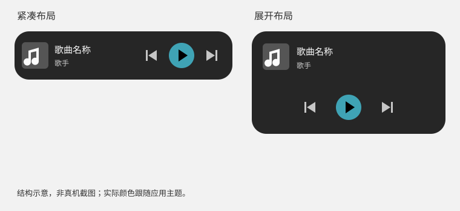

# Android 桌面播放器

在系统桌面的小部件列表中添加「MusicFree · 播放器」。默认显示一行播放器；向下放大后，歌曲信息与播放控制分为两行。两种布局均保留上一首、播放/暂停、下一首，控制区域至少为 48dp。



## 行为

- 点击封面或歌曲信息打开 MusicFree。空队列点击播放控制时，提示先在应用内选择歌曲。
- 播放控制使用现有业务播放器，保留插件取源、播放队列和循环模式；不会直接操作原生单曲队列来切歌。
- 进程被系统回收后，点击控制通过现有播放服务恢复插件与队列，再执行动作，不需要先打开页面。Android 的「强行停止」限制仍然适用。
- 页面与后台共用初始化 Promise。后台播放后打开应用不会再次恢复旧队列，也不会因为「启动应用自动播放」设置覆盖本次桌面操作。
- 小部件跟随应用主题，使用不透明背景；自定义颜色仅在小部件显示时调整对比度，不修改已保存的主题。正文对比度至少为 4.5:1，控制图标至少为 3:1。
- 歌曲和播放状态通过事件刷新，不定时轮询进度。原生仅持久化歌曲信息和颜色，进程重建后不会错误地沿用「正在播放」状态。
- 封面加载限制为 4MiB、7 秒，解码缩放至 192×192；过期请求不能覆盖新歌曲。失败显示应用现有默认封面。

## 原生服务适配

`postinstall` 运行 `scripts/patch-track-player-widget.js`，适配现有 RNTP 4.1.x 的两处 Kotlin 文件：

1. 桌面点击直接启动 RNTP 的 `MusicService`，在加载 Hermes、插件之前进入前台，满足系统时限。
2. 只有该服务正在处理显式的小部件请求时，允许后台 `setupPlayer`；初始化绑定已经启动的服务，不再延迟启动第二次前台服务。
3. 独立的 `MusicFreeWidget` Headless JS 任务执行操作，结束后释放请求。120 秒超时会释放前台启动状态；排队的过期操作会被丢弃。
4. 非播放状态退出临时前台；正常播放继续使用 RNTP 已有的媒体通知。

脚本可重复运行；遇到不兼容的依赖源码锚点时，在写入任一文件之前失败，避免静默漏打补丁。升级 RNTP 时应重新检查补丁与真机行为。

`index.js` 只注册一个延迟加载页面的根组件。后台任务不调用权限弹窗、导航或开屏初始化。

## 范围

本功能使用 Android 标准 AppWidget，不接入厂商小部件商店。iOS 不新增小部件。此提交从 Audiora 的桌面播放器实现提取，未引入其拾音推荐、专用插画、车机、音效或预览发布设置，也不修改 MusicFree 的包名、应用名及依赖版本。

## 验证

```sh
npm ci
npm test -- --runInBand
npx tsc --noEmit
npm run lint -- --no-fix
node scripts/patch-track-player-widget.js
```

自动化覆盖播放状态快照竞争、快速点击串行执行、错误恢复、队列初始化共享、失败重试、过期请求、冷启动页面隔离、主题对比度和原生补丁重复应用。

真机验收仍需由测试人员执行，编译和 JS 测试不替代以下检查：

1. 有歌曲、无歌曲、暂停、播放、缓冲及取源失败；列表、随机和单曲循环下切歌。
2. 缩放、多个实例、深浅壁纸、大字体、读屏、主题切换和自定义半透明颜色。
3. 应用在前台、后台及进程回收后控制播放；随后打开应用，核对队列和播放状态不变。
4. 本地、网络和 content URI 封面；无网络及快速切歌时的默认封面与迟到请求。
5. 冷启动失败后通知释放、再次点击恢复，以及锁屏通知、耳机和蓝牙控制。
